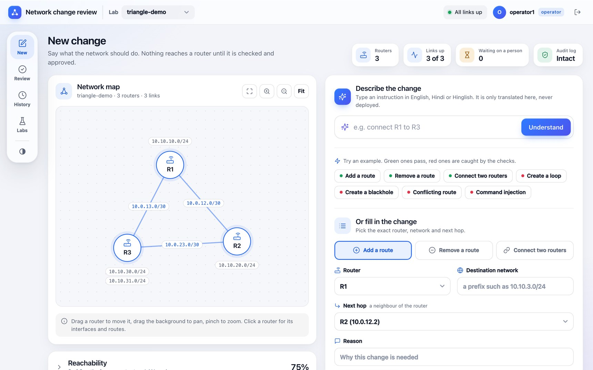
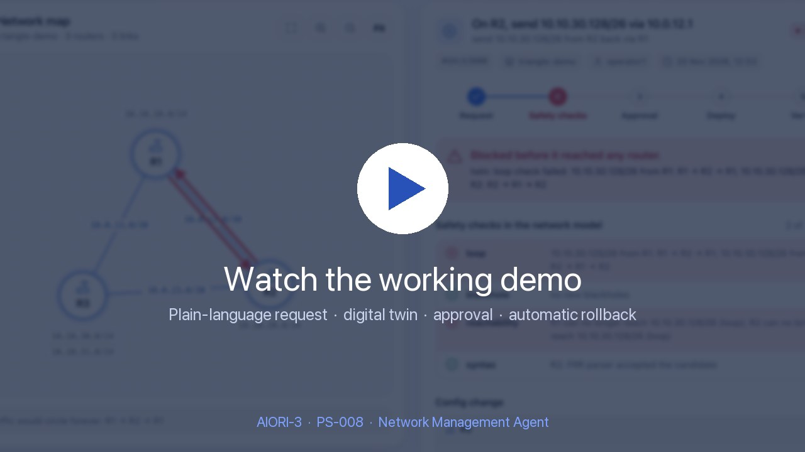
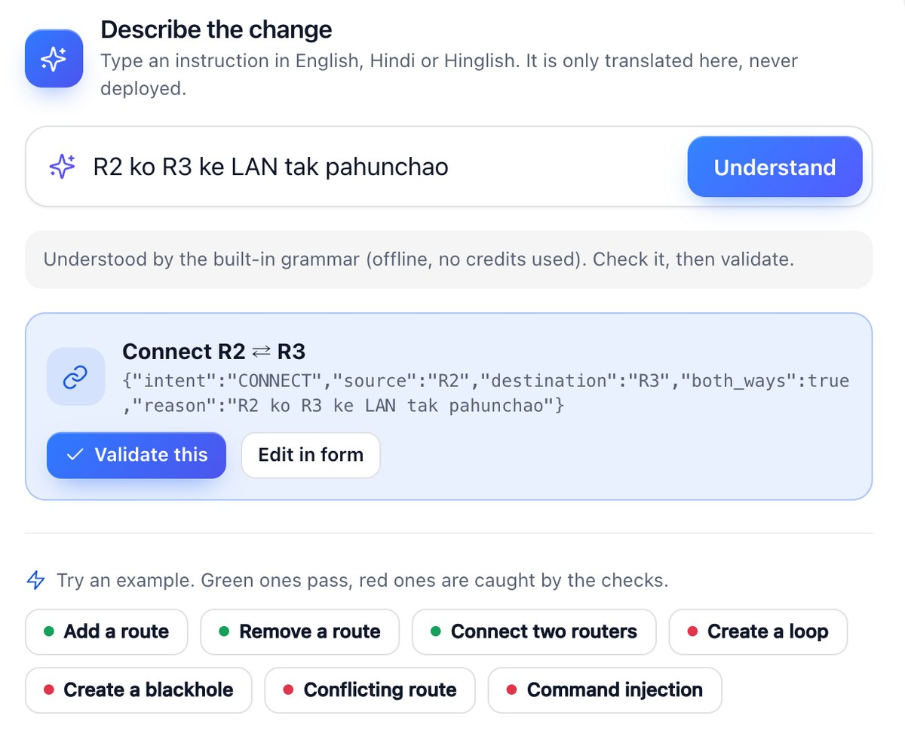
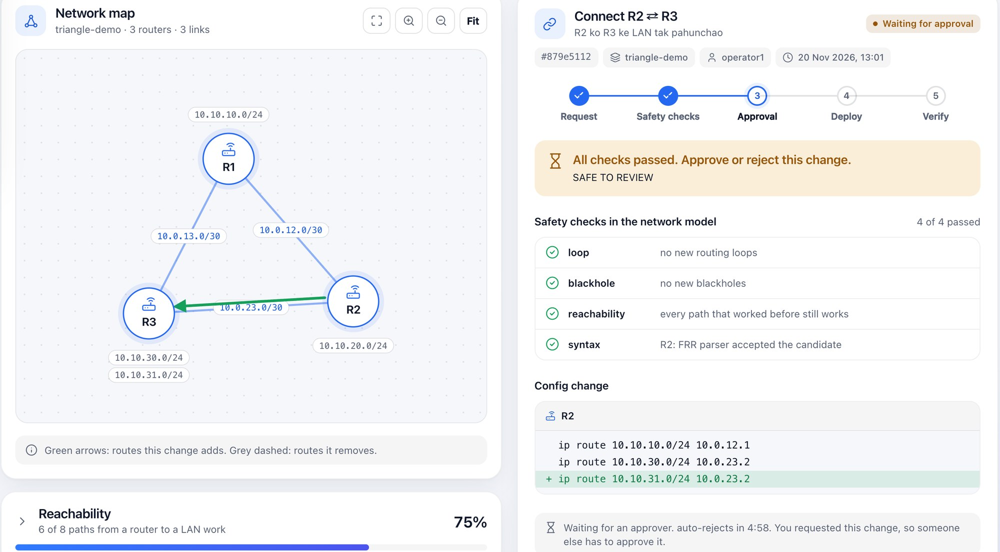
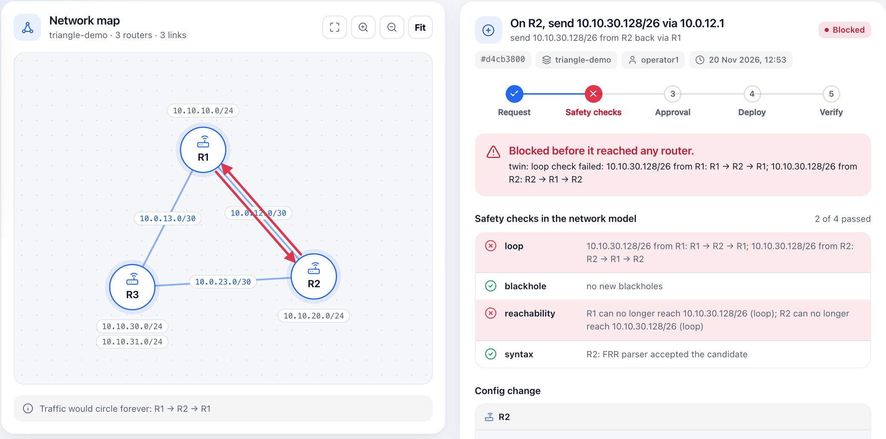
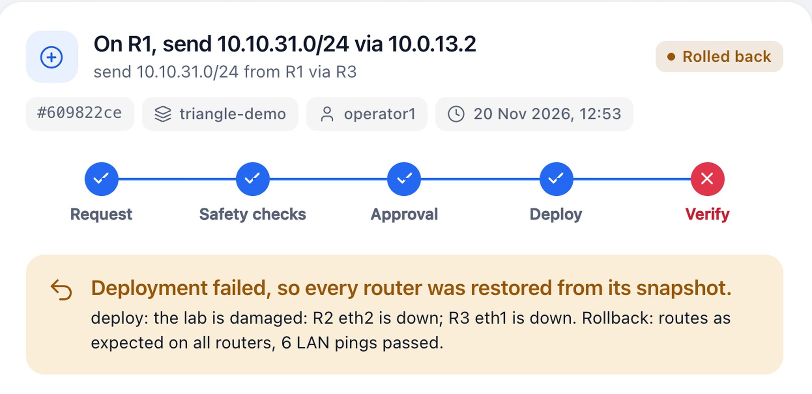
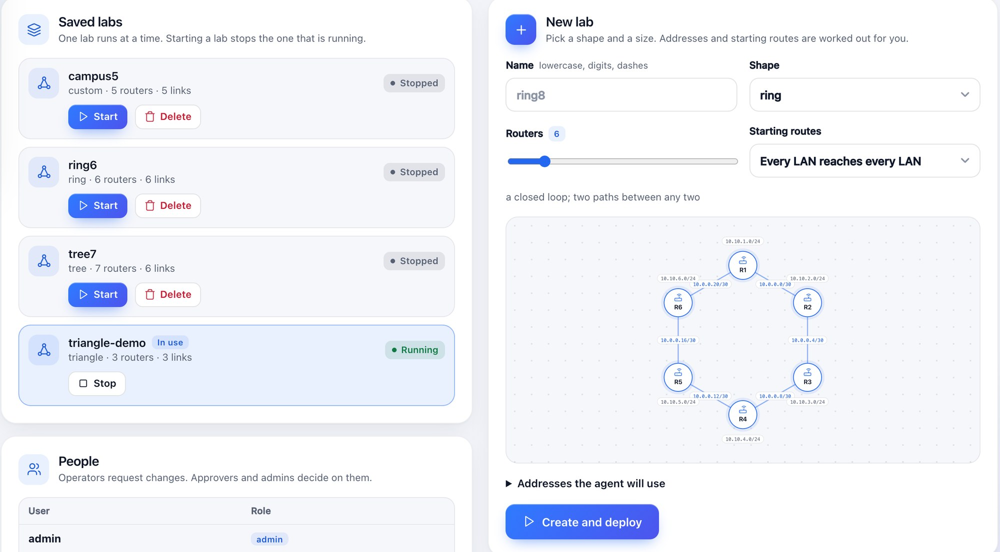
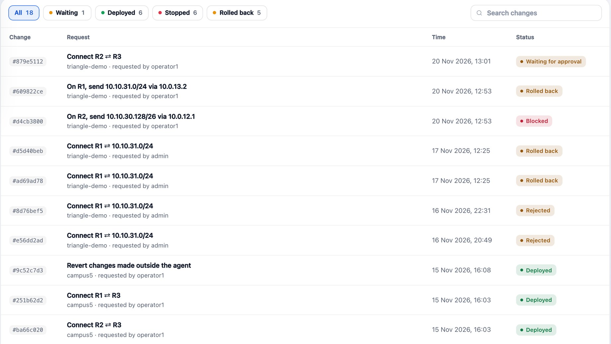
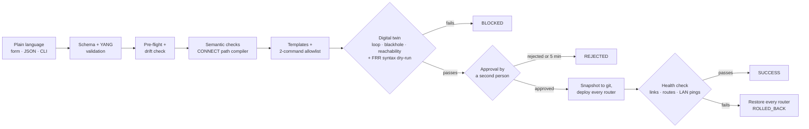

<div align="center">
  <picture>
    <source media="(prefers-color-scheme: dark)" srcset="docs/media/logo/logo-dark.svg">
    
  </picture>
</div>

# PS-008: Network Management Agent for Reviewed Configuration Changes

An intent-based network agent that turns a plain-language request into router commands. It proves the change is safe in a digital twin, waits for a second person to approve it, deploys it to real FRR routers, and rolls every router back automatically if anything fails.

<div align="center">
  <a href="https://portal.aiori.in/aiori-3/hackathon-guideline/"></a>
  <a href="docs/JUDGES.md#1-every-requirement-with-proof"></a>
  <a href="docs/JUDGES.md"></a>
  <br>
  <a href="https://www.python.org/"></a>
  <a href="https://frrouting.org/"></a>
  <a href="docs/test-results.txt"></a>
  <a href="yang/nma-intent.yang"></a>
  <a href="https://youtu.be/j9w14NcGQWg"></a>
</div>

<br>

<div align="center">
  
  <br>
  <sub>The dashboard on the 3-router testbed. Nothing reaches a router until it is checked and approved.</sub>
</div>

<div align="center">

### Watch the demo

<a href="https://youtu.be/j9w14NcGQWg"></a>

<sub><a href="https://youtu.be/j9w14NcGQWg">Working demo</a> · <a href="https://youtu.be/WGWgj6Aavbs">Team introduction</a></sub>

</div>

**Jump to:** [Judge fast path](#judge-fast-path) · [Headline results](#headline-results) · [See it work](#see-it-work) · [How it works](#how-it-works) · [Requirements coverage](#requirements-coverage) · [Quickstart](#quickstart) · [Daily use](#daily-use) · [Intents](#intents) · [Standards](#standards-yang-and-netconf) · [Tests](#tests) · [Security](#security-principles) · [Repository map](#repository-map) · [Honest limits](#honest-limits) · [References](#references)

| Name | Role |
| :--- | :--- |
| **Mukul Goyal** | Team Lead |
| **Ishika Pandey** | Team Member |
| **Dr. Tejaswi Khanna** | Faculty Guide |

**Team code:** A3-PS008-TC065  
**Category:** Cybersecurity  
**Presentation:** [`A3-PS008-TC065 Network Management Agent.pdf`](A3-PS008-TC065%20Network%20Management%20Agent.pdf)  
**Working demo:** https://youtu.be/j9w14NcGQWg  
**Team introduction:** https://youtu.be/WGWgj6Aavbs

## Judge fast path

- **Every PS-008 requirement, with proof:** [`docs/JUDGES.md`](docs/JUDGES.md#1-every-requirement-with-proof), printable as [`docs/judge-sheet.pdf`](docs/judge-sheet.pdf)
- **Demo video:** https://youtu.be/j9w14NcGQWg
- **Test results:** [`docs/test-results.txt`](docs/test-results.txt): 72 checks pass offline and on real FRR routers
- **Run it yourself:** [Quickstart](#quickstart), then `.venv/bin/python -m pytest -q` (no routers needed)
- **What it does not do:** [Honest limits](#honest-limits)

## Headline results

| What | Result | How to check |
| :--- | :--- | :--- |
| Automated checks, offline | **72 of 72 pass** (48 scenarios) | `.venv/bin/python -m pytest -q` |
| Same suite on the real FRR routers of `triangle-demo` | **72 of 72 pass** | `NMA_LIVE=1 .venv/bin/python -m pytest -q` |
| Fresh labs built, connected, broken on purpose and rolled back, end to end | **3 of 3 pass** (ring of 6, tree of 7, partial mesh of 8) | `NMA_LIVE_LABS=1 .venv/bin/python -m pytest -q tests/test_live_labs.py` |
| Commands that can ever reach a router | **2**: `ip route` and `no ip route` | The allowlist in `backend/generator.py`; test 13 |
| Digital-twin check on a 30-router lab | **under 1 second** | Test 39 |
| LAN pings checked after a deploy on a 7-router tree | **42**, every pair the twin predicts | Test 40 |
| A change nobody approves | **rejected after 5 minutes** | Test 10 |
| Confirmed-commit window (RFC 6241 §8.4) | **10 s to 1 h**, then automatic undo | Tests 42 to 45 |
| Audit log | **SHA-256 hash chain**, any edit detected | `.venv/bin/python agent.py verify-audit`; test 20 |

Results recorded in [`docs/test-results.txt`](docs/test-results.txt): offline suite re-run on 2026-11-24, live suite on 2026-11-17, generated labs on 2026-11-15.

## See it work

<table>
<tr>
<td width="50%"><br><b>Ask in plain words.</b> English, Hindi or Hinglish. The built-in grammar understands common requests offline; the AI only translates and never writes a command.</td>
<td width="50%"><br><b>Review before anything runs.</b> Each new route is drawn on the map, and every safety check is listed with its result.</td>
</tr>
<tr>
<td><br><b>Loops and blackholes are blocked.</b> The digital twin follows every packet first and draws the problem in red. Nothing reached a router.</td>
<td><br><b>Failures undo themselves.</b> A link went down after deploy; every router was restored from its snapshot and re-checked.</td>
</tr>
<tr>
<td><br><b>Any topology.</b> Pick a template or draw your own. The agent generates the lab, deploys it and draws the map.</td>
<td><br><b>Every change on record.</b> Who asked, who approved, and whether it was deployed, blocked, rejected or rolled back.</td>
</tr>
</table>

## How it works



1. **You design the lab.** Pick a template or draw a topology. The agent generates the containerlab file and every router config, deploys it and draws the map.
2. **You ask for a change** as a form, as JSON, or in plain language ("connect R1 to R4", "R1 ko R4 tak pahunchao").
3. **The agent compiles it** into router commands from fixed templates. Only `ip route …` and `no ip route …` can ever pass.
4. **The digital twin proves it is safe:** no loop, no blackhole, no working path lost. FRR's own parser checks the syntax.
5. **A second person approves it.** Nobody can approve their own change, and a change nobody approves expires.
6. **The agent deploys it to every router as one transaction,** verifies it, and rolls back every router automatically if anything fails. It can also deploy as a NETCONF-style **confirmed commit**: the change is live but undoes itself unless someone confirms it in time.

Every step lands in a tamper-evident audit log. A language model is optional: if one is configured, it only proposes intent JSON, which goes through every check above.

## Requirements coverage

Every line of the PS-008 problem statement and how we prove it. The full table, with the files and tests behind each row, is in [`docs/JUDGES.md`](docs/JUDGES.md#1-every-requirement-with-proof).

| # | PS-008 asks for | Status | Proof |
| :--- | :--- | :--- | :--- |
| K1 | One router platform and a 3-router lab testbed | Met | FRR 10.2.1 only; `labs/triangle-demo` is the 3-router testbed. Any topology up to 30 routers also works |
| K2 | 2 mentor-defined intents | Met | `ADD_ROUTE`, `REMOVE_ROUTE`; the extra `CONNECT` compiles into the same two commands |
| K3 | A structured intent schema | Met | Pydantic schema and a YANG 1.1 model that passes `pyang --strict --lint` |
| K4 | Validate candidate configurations before deployment | Met | Digital twin, FRR syntax dry-run and lab pre-flight; tests 07, 08, 17, 32 |
| K5 | A clear human approval gate | Met | A different person must approve; 5-minute timeout; tests 09, 10, 31, 37 |
| K6 | Automatic rollback after a failed deployment | Met | Snapshot to git, restore every router, re-check; tests 11, 12, 19, 33, 43 |
| K7 | At least 12 tests across the 4 categories | Met | 48 scenarios and 72 checks covering conflicting routes, invalid configurations, rejected approvals and failed deployments |
| K8 | LLM use is optional | Met | The offline grammar works with no AI and no internet; tests 28 to 30, 41 |
| K9 | No multi-vendor, unrestricted commands or production access | Met | FRR only; 2-command allowlist; isolated lab VM; test 13 |
| R1 | NETCONF, RFC 6241 | Partly | Confirmed commit (§8.4) is built, tests 42 to 45; the transport to routers is `docker exec`, not NETCONF |

## Quickstart

Containerlab needs Linux, so the routers run in an OrbStack Linux machine called `clab`. The agent runs on the Mac and reaches them through `orb -m clab docker …`.

**Fastest check, no routers needed:**

```bash
python3 -m venv .venv && .venv/bin/pip install -r requirements.txt
```

```bash
.venv/bin/python -m pytest -q
```

**Full setup (macOS, one time):**

**1.** Install OrbStack (`brew install orbstack`), open it once, then create the machine:

```bash
orb create ubuntu clab
```

**2.** Install Docker and Containerlab inside it:

```bash
orb -m clab bash -c 'curl -sL https://containerlab.dev/setup | sudo -E bash -s "all"'
```

**3.** Pull the FRR router image:

```bash
orb -m clab docker pull quay.io/frrouting/frr:10.2.1
```

**4.** Set up Python on the Mac (skip if you did the fastest check):

```bash
python3 -m venv .venv && .venv/bin/pip install -r requirements.txt
```

**5.** Deploy the 3-router testbed and check it is healthy. `status` prints **GO**, or **NO-GO** with the command that fixes it:

```bash
.venv/bin/python agent.py lab deploy triangle-demo
```

```bash
.venv/bin/python agent.py status
```

**6.** Optional, for plain language in any language: copy `.env.example` to `.env` and fill in your OpenAI-compatible endpoint, key and model. Without it, the offline grammar still handles English and common Hinglish phrasing.

## Daily use

Start the dashboard at http://localhost:8000:

```bash
.venv/bin/uvicorn backend.main:app --port 8000
```

On first start it creates the user `admin` and writes the password to `data/initial-admin-password`. Add people from the Labs tab, or from the terminal:

```bash
.venv/bin/python agent.py user add ishika --role approver
```

| Role | Can |
| :--- | :--- |
| **operator** | Propose changes |
| **approver** | Also approve or reject changes. Nobody can approve their own change |
| **admin** | Also manage labs and users, and accept drift |

Terminal equivalents (`python agent.py --help` lists all):

```bash
.venv/bin/python agent.py lab new ring8 --template ring --routers 8
```

```bash
.venv/bin/python agent.py lab deploy ring8
```

```bash
.venv/bin/python agent.py ask "connect R1 to R5"
```

### Lab file format

Minimal; addresses, interfaces and starting routes are derived:

```yaml
name: campus
routers: [R1, R2, R3, R4]
links: [[R1, R2], [R2, R3], [R3, R4], [R4, R1], [R1, R3]]
baseline: shortest-path        # or none: start empty and build routing with CONNECT
```

Optional: per-router LANs (`R3: {lans: [10.10.30.1/24]}`), fixed link subnets (`{a: R1, b: R2, subnet: 10.0.12.0/30}`), extra `routes`, and a saved map `layout`. See `labs/triangle-demo/lab.yaml`. Limit: 30 routers per lab (4 GB VM).

## Intents

| Intent | Example | What the agent does |
| :--- | :--- | :--- |
| `ADD_ROUTE` | R1, 10.10.31.0/24, next hop R3 | One static route; the next hop must be a direct neighbour |
| `REMOVE_ROUTE` | R1, 10.10.30.128/25 | Looks up the existing next hop, then removes the route |
| `CONNECT` | R1 ⇄ R4 | Shortest path over the links; adds only the routes missing on each hop, in both directions, as one transaction |

## Standards: YANG and NETCONF

The problem statement points to NETCONF (RFC 6241) and YANG (RFC 7950). The agent uses both ideas where they fit a lab of FRR routers:

| Standard | What the agent does |
| :--- | :--- |
| **YANG 1.1** (RFC 7950) | `yang/nma-intent.yang` models every intent and the review workflow as RPCs: `submit-intent`, `approve-change`, `reject-change`, `confirm-change`, `cancel-change`. Rules live in the model itself: `when` (next hop only for ADD_ROUTE), `must` (routes need a prefix), `mandatory`, IETF address types (RFC 6991), safe-text patterns |
| **JSON encoding** (RFC 7951) | Each API body is the JSON form of the matching RPC input. `backend/yangcheck.py` validates every request against the model with yangson, in addition to the lab-aware Pydantic check |
| **IETF module guidelines** (RFC 8407) | The module passes `pyang --strict --lint`. A test fails if it ever stops passing |
| **NETCONF confirmed commit** (RFC 6241 §8.4) | An approver can deploy with a confirm timeout (10 s to 1 h). The change is live and verified, but every router is restored from the snapshot unless another approver confirms in time. "Roll back now" is cancel-commit. While a change waits, no other change can start |
| **Candidate, validate, commit** (the NETCONF model) | The candidate is checked in the digital twin and by FRR's parser before anything is committed, and the running config is snapshotted before every commit |

```bash
.venv/bin/pyang --strict --lint yang/nma-intent.yang          # lint the module
.venv/bin/pyang -f tree yang/nma-intent.yang                  # print its tree
.venv/bin/python agent.py yang-check intents/6-injection.json # check a request against the model
.venv/bin/python agent.py apply intents/1-add-route.json --confirm 60   # deploy as a confirmed commit
.venv/bin/python agent.py confirm <id>    # or: agent.py cancel <id>
```

<details>
<summary><b>Demo script (about 7 minutes)</b></summary>

1. **Labs tab:** draw a 5-router lab (or pick a template), "Create and deploy". The map draws itself and the reachability table shows 0 paths.
2. **Plain language:** type "R1 ko R4 tak pahunchao" and click Understand. Check the CONNECT card and validate it. Blue arrows show the routes on every hop. Approve as a different user; the table shows the new paths.
3. **Separation of duties:** as the requester, the dashboard refuses to let you approve your own change.
4. **Loop / blackhole:** use the generated example buttons. The twin blocks them and draws the path in red or amber.
5. **Failed deploy:** approve with the failure test "A link goes down after deploy". The dead link is detected, every router is restored, and the status is ROLLED_BACK.
6. **Drift:** on a router, `vtysh -c 'conf t' -c 'ip route 10.10.99.0/24 <neighbour IP>'`. The banner appears and new changes are blocked. "Revert through approval", then approve.
7. **Confirmed commit:** approve a change with "Deploy as: Confirmed commit, undo in 2 min". It goes live and the pings pass, then the review page counts down. Do nothing and every router rolls back by itself, or press "Confirm and keep" as another approver.
8. **Broken lab:** `orb -m clab docker restart clab-<lab>-r1`, then submit a change. Pre-flight refuses it and names the missing interfaces. Redeploy the lab.
9. **History and tests:** `python -m pytest -q`, which runs 72 checks offline.

The timed five-minute version, the morning checklist and the backup plans are in [`docs/JUDGES.md`](docs/JUDGES.md#3-five-minute-run-of-show).

</details>

## Tests

| File | What | How to run |
| :--- | :--- | :--- |
| `tests/test_scenarios.py` | The original 20 scenarios: the 4 PS categories, happy paths, injection, audit | Offline; `NMA_LIVE=1` on real routers |
| `tests/test_round2.py` | 20 more: templates, addressing, CONNECT, plain language, LLM validation, pre-flight, drift, login and roles, API identity, examples, speed | Offline; `NMA_LIVE=1` on real routers |
| `tests/test_standards.py` | 8 more: confirmed commit (confirm, time out, cancel, bounds), YANG lint, YANG rejects what the model forbids, YANG accepts real requests | Offline; `NMA_LIVE=1` on real routers |
| `tests/test_live_labs.py` | Generate ring, tree and partial-mesh labs, deploy, CONNECT, forced rollback, destroy | `NMA_LIVE_LABS=1` |

How the 4 PS categories are covered:

| PS category | Tests |
| :--- | :--- |
| Conflicting routes | 07, 14, 27 |
| Invalid configurations | 03, 04, 05, 06, 13, 16, 47 |
| Rejected approvals | 09, 10, 31 |
| Failed deployments | 11, 12, 33, 43 |

Results: [`docs/test-results.txt`](docs/test-results.txt) (72 checks offline, 72 on the real triangle-demo routers, 3 of 3 generated labs live, all passing).

## Security principles

| Principle | Where |
| :--- | :--- |
| Least privilege | Three intents only; roles operator, approver and admin (`auth.py`, `main.py`) |
| No arbitrary commands | Templates and a strict allowlist (`generator.py`); LLM output is intents, never CLI (`nlp.py`) |
| Input validation | Two independent checks: the published YANG model (`yangcheck.py`) and Pydantic with `extra="forbid"`, typed IPs, safe-text patterns and lab-aware router names (`schema.py`) |
| Test before change | Pre-flight lab health, digital twin, FRR `vtysh --dryrun` (`deploy.py`, `twin.py`, `lab.py`) |
| Human-in-the-loop | Approval required; timeout means rejected; the requester can never approve their own change (`engine.py`) |
| Authentication | scrypt password hashes, HttpOnly session cookie, identity taken from the session, not the request (`auth.py`) |
| Safe recovery | Git-committed snapshots, all-router rollback, re-verified after rollback (`deploy.py`); confirmed commit undoes a change nobody confirms (`engine.py`) |
| Consistency | Drift detection blocks changes while routers differ from the approved state (`engine.py`) |
| Auditability | Every stage, every plain-language request, every login-protected action; SHA-256 hash chain (`audit.py`) |
| Isolation | Lab only, single vendor (FRR), next hops must be lab routers |
| Untrusted AI | LLM output is validated by the same schema; unknown fields and routers are dropped; a human approves |

## Repository map

| Path | What it is |
| :--- | :--- |
| `agent.py` | Terminal front end: labs, changes, plain language, users, drift, GO / NO-GO status |
| `backend/main.py`, `backend/static/` | FastAPI and the dashboard (map, lab builder, review, history) |
| `backend/engine.py` | The pipeline, approval timeout, separation of duties, confirmed commit, drift detection |
| `backend/schema.py` | Stage 1: intents `ADD_ROUTE`, `REMOVE_ROUTE`, `CONNECT` (Pydantic, checked against the active lab) |
| `backend/yangcheck.py` | Stage 1, second check: the request must be valid against the YANG model (yangson) |
| `backend/checks.py` | Stage 2: semantic checks and the CONNECT path compiler |
| `backend/generator.py` | Stage 3: Jinja2 templates and the strict command allowlist |
| `backend/twin.py` | Stage 4: digital twin (loop, blackhole, reachability) |
| `backend/deploy.py` | Pre-flight, snapshot and git, deploy, health check, rollback, fault injection |
| `backend/lab.py` | The only code that talks to routers (`docker exec … vtysh`, in parallel), FRR dry-run syntax check |
| `backend/nlp.py` | Plain language to intents (offline grammar, else any OpenAI-compatible LLM) |
| `backend/auth.py` | Users, roles, scrypt passwords, sessions |
| `backend/audit.py` | SQLite audit log with a SHA-256 hash chain |
| `backend/topology.py` | Loads a lab: automatic addressing, validation, fast lookups, shortest paths |
| `backend/labgen.py` | Templates (line, triangle, ring, star, mesh, tree, partial mesh) and config generation |
| `backend/labctl.py` | Deploy and stop labs with containerlab in the VM, readiness wait, active lab |
| `backend/examples.py` | Demo examples found by the twin for whatever lab is active |
| `labs/<name>/lab.yaml` | A lab as data: routers, links, optional addresses, routes and layout. Everything else is generated into `labs/<name>/build/` (not committed) |
| `yang/` | The YANG 1.1 module `nma-intent.yang` and its tree |
| `intents/` | Ready-made example requests: add, remove, loop, blackhole, conflict, injection |
| `tests/` | 48 scenarios (72 checks), offline and live, plus end-to-end runs on generated labs |
| `docs/` | [`JUDGES.md`](docs/JUDGES.md) (requirements, limits, Q&A), [`judge-sheet.pdf`](docs/judge-sheet.pdf), [`test-results.txt`](docs/test-results.txt), [`pseudocode.md`](docs/pseudocode.md), [`intent-schema.json`](docs/intent-schema.json), screenshots in `media/` |
| `data/`, `snapshots/` | Runtime state: audit database, users and the snapshot git repo (not committed) |

## Honest limits

This is a lab prototype, and we would rather state its limits than have you find them.

- **Lab only, FRR only, IPv4 static routes only.** That is the scope PS-008 sets.
- **The twin models static routing.** It does not model OSPF or BGP, ACLs or traffic load. A protocol model or Batfish would be the next step.
- **The transport is `docker exec vtysh`, not NETCONF or SSH.** The YANG model and confirmed commit follow the standards; only `backend/lab.py` talks to routers, so moving to a NETCONF client such as ncclient means changing one file.
- **One lab and one change at a time.** A global lock keeps changes in order.
- **Sessions live in memory.** Restarting the server signs everyone out.
- **The language model can misunderstand.** That is why it only fills in an intent card for a person to check, and every check still runs afterwards.
- **The audit log is tamper-evident, not tamper-proof.** Someone with full database access could rewrite the whole chain; production would store the latest hash elsewhere.
- **Tested in a lab on one laptop,** not on physical routers.

## References

1. A. Clemm, L. Ciavaglia, L. Z. Granville, J. Tantsura. *Intent-Based Networking: Concepts and Definitions.* RFC 9315, IRTF, October 2022.
2. R. Enns, M. Bjorklund, J. Schoenwaelder, A. Bierman (eds.). *Network Configuration Protocol (NETCONF).* RFC 6241, IETF, June 2011.
3. M. Bjorklund (ed.). *The YANG 1.1 Data Modeling Language.* RFC 7950, IETF, August 2016.
4. C. Zhou et al. *Network Digital Twin: Concepts and Reference Architecture.* Internet-Draft draft-irtf-nmrg-network-digital-twin-arch, IRTF NMRG.
5. M. Bjorklund et al. *Network Management Datastore Architecture (NMDA).* RFC 8342, IETF, March 2018.
6. A. Fogel et al. *A General Approach to Network Configuration Analysis.* USENIX NSDI, 2015.
7. P. Kazemian, G. Varghese, N. McKeown. *Header Space Analysis: Static Checking for Networks.* USENIX NSDI, 2012.
8. FRRouting Project. *FRRouting User Guide.* https://docs.frrouting.org
9. Containerlab. *Containerlab Documentation.* https://containerlab.dev

---

<div align="center">
  
</div>

<sub>PS-008 Network Management Agent for Reviewed Configuration Changes</sub>  
<sub>Team A3-PS008-TC065 · AIORI-3 Hackathon · Cybersecurity</sub>  
<sub>[Judge pack](docs/JUDGES.md) · [Judge sheet](docs/judge-sheet.pdf) · [Demo video](https://youtu.be/j9w14NcGQWg) · [Test results](docs/test-results.txt) · [Honest limits](#honest-limits) · [Back to top](#ps-008-network-management-agent-for-reviewed-configuration-changes)</sub>  
<sub>Built on FRRouting, Containerlab, FastAPI, Pydantic, yangson and pyang</sub>

<div align="center">
  <sub><em>Understood, proven, approved and reversible.</em></sub>
</div>
